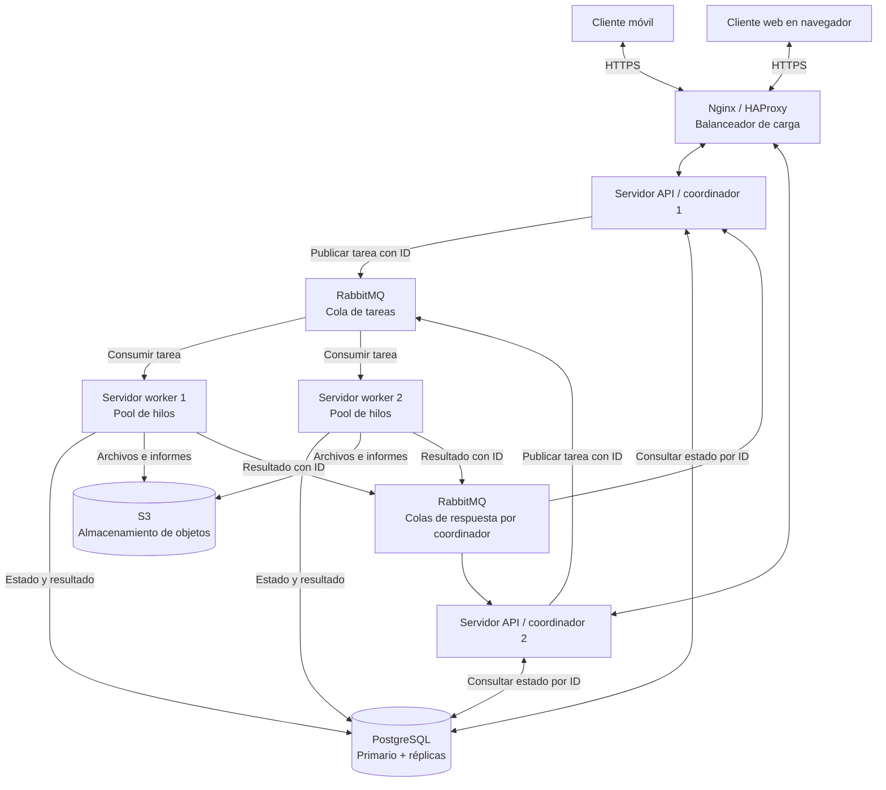
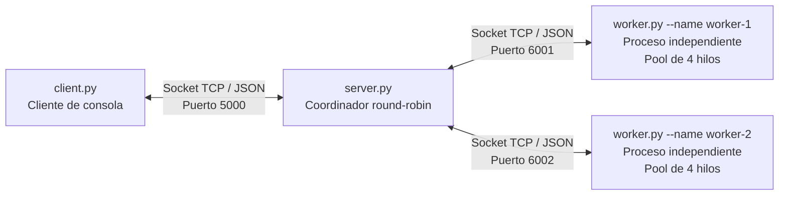

# Diagrama del sistema distribuido

Este documento utiliza Mermaid, que GitHub representa como un diagrama al abrir el archivo.

## Arquitectura completa propuesta

Los coordinadores publican tareas; los workers compiten por consumirlas. Cada tarea se asigna a un consumidor, no se difunde deliberadamente a todos. El coordinador indica una cola de respuesta y un identificador de correlación para asociar el resultado con el solicitante. Las flechas de respuesta representan rutas hacia el coordinador correspondiente, no una difusión de cada resultado a ambos.

En una aplicación web, el navegador usa HTTPS o WebSocket; no puede conectarse directamente al protocolo TCP arbitrario de esta práctica. La capa API adapta ese acceso. Nginx/HAProxy distribuye solicitudes entre APIs; RabbitMQ distribuye tareas entre workers: cumplen funciones diferentes.

PostgreSQL almacena registros estructurados; S3 almacena objetos como archivos. Un PostgreSQL aislado no es por sí solo una base distribuida: el diseño propone primario y réplicas, con escrituras al primario. S3 no reemplaza las consultas relacionales. La configuración de replicación, failover y consistencia debe definirse antes de un despliegue real.

Una implementación con RabbitMQ debe confirmar la tarea después de procesarla y persistirla, controlar tareas en vuelo y admitir que pueda haber reentregas. El ID permite implementar idempotencia. Una cola durable por sí sola no garantiza procesamiento exactamente una vez.

## Arquitectura implementada en Python

El prototipo utiliza sockets directos en lugar de RabbitMQ. No ejecuta Nginx, PostgreSQL, S3 ni interfaces web/móviles. Estos componentes pertenecen al diseño del punto 1. El código implementa el punto 2 con procesos separados y comunicación real por red; no simula workers únicamente con hilos del coordinador.
